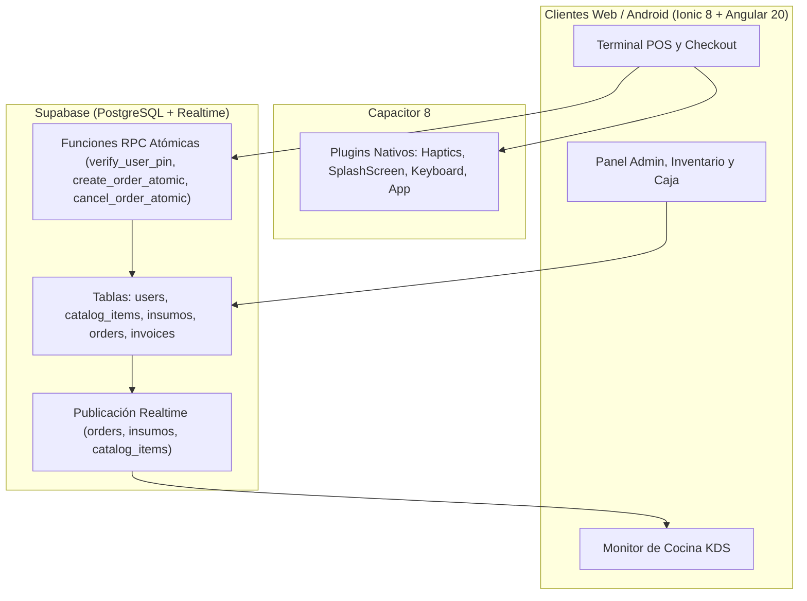

# Donde Kike POS — La Esquina del Sabor

Sistema de punto de venta (POS), monitor de cocina en tiempo real (KDS), control de inventario y cierre de caja para **Donde Kike**. Desarrollado por **Owen Badel Hooker** (Ingeniero de Sistemas).

[](https://angular.dev/)
[](https://ionicframework.com/)
[](https://supabase.com/)

---

## Qué resuelve la aplicación

**Donde Kike POS** centraliza la operación diaria de un restaurante de comida rápida en una interfaz móvil y de escritorio:

- **Terminal POS (Maestro-Detalle):** catálogo categorizado, búsqueda instantánea, validación de stock por receta antes de agregar al pedido, adición de queso extra y modal de cobro con cálculo de cambio en efectivo o transferencia.
- **Monitor de Cocina (KDS):** tablero oscuro de alto contraste sincronizado por WebSockets (Supabase Realtime) con temporizador por comanda, niveles de urgencia, notas limpias de preparación y alertas sonoras silenciables.
- **Inventario por Recetas:** control de insumos vinculados a cada plato con descuento automático en transacciones atómicas, alertas de stock mínimo y botones de reabastecimiento rápido (`-1`, `+1`, `+5`).
- **Historial y Cierre de Caja:** consulta filtrable de pedidos y comprobantes, arqueo diario discriminado entre efectivo y transferencias, ticket promedio y gráfica de tendencia de los últimos 14 días.
- **Control de Acceso por Rol (RBAC):** ingreso por usuario y PIN de 4 dígitos con hash `pgcrypto` en PostgreSQL y vistas diferenciadas para *Administrador*, *Mesero / Caja* y *Cocina*.

---

## Arquitectura



---

## Instalación y ejecución local

### Prerrequisitos
- Node.js 20 LTS o superior
- Angular CLI (`@angular/cli`)
- Proyecto configurado en Supabase con el esquema de [supabase-schema.sql](supabase-schema.sql)

### Pasos

```bash
git clone https://github.com/OwenBadel/DondeKike.git
cd DondeKike
npm install
```

Configurar `src/environments/environment.ts` y `src/environments/environment.prod.ts` con la URL y la clave pública (`anon key`) del proyecto Supabase.

```bash
# Servidor local de desarrollo
npm start

# Compilación de producción
npm run build:prod

# Validación de estilo y pruebas unitarias
npm run lint
npm run test:ci

# Sincronización con Android (Capacitor)
npm run sync
```

---

## Autoría y contacto

- **Owen Badel Hooker** — Ingeniero de Sistemas
- **GitHub:** [@OwenBadel](https://github.com/OwenBadel)
- **LinkedIn:** [linkedin.com/in/owen-badel-175851371](https://www.linkedin.com/in/owen-badel-175851371/)
